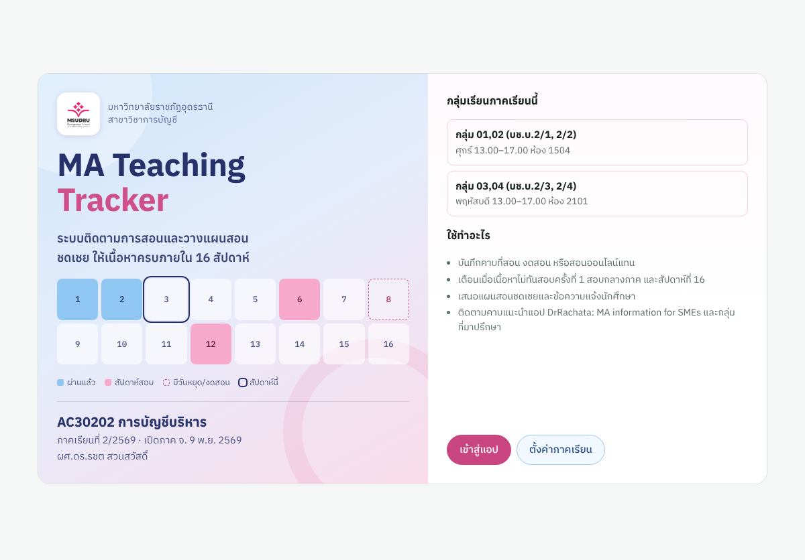

# MA Teaching Tracker

ระบบติดตามการสอนและวางแผนสอนชดเชย สำหรับรายวิชา **AC30202 การบัญชีบริหาร 3(2-2-5)**
สาขาวิชาการบัญชี คณะวิทยาการจัดการ มหาวิทยาลัยราชภัฏอุดรธานี

ผู้พัฒนา: ผศ.ดร.รชต สวนสวัสดิ์



## ที่มาและวัตถุประสงค์

ภาคเรียนหนึ่งมีเวลาสอน 16 สัปดาห์ (สัปดาห์ละ 4 ชั่วโมง) แต่บางสัปดาห์ต้องงดสอนเพราะวันหยุด กิจกรรมมหาวิทยาลัย หรือการประชุมผู้บริหาร แอปนี้ช่วยให้ผู้สอน

1. บันทึกว่าแต่ละคาบได้สอนจริง สอนบางส่วน สอนออนไลน์แทน หรืองดสอน
2. รู้ล่วงหน้าว่าเนื้อหาจะไม่ทันจุดตรวจสอบใด (สอบครั้งที่ 1, สอบกลางภาค, สิ้นสัปดาห์ที่ 16)
3. ได้ข้อเสนอแผนสอนชดเชย พร้อมข้อความแจ้งนักศึกษา
4. ติดตามคาบแนะนำแอป **DrRachata: MA information for SMEs** และกลุ่มงานที่มาปรึกษา

แนวคิดหลักมาจากการทำแผนที่หลักสูตร (curriculum mapping) ที่เชื่อมเนื้อหากับเวลาเรียนและการประเมิน (Harden, 2001) และการวัดความก้าวหน้าเทียบแผนแบบ Schedule Performance Index (SPI = ชั่วโมงที่สอนแล้ว ÷ ชั่วโมงตามแผน ณ วันนี้)

## ส่วนประกอบของแอป

| แท็บ | ใช้ทำอะไร |
|---|---|
| หน้าปก | ชื่อรายวิชา ภาคเรียน กลุ่มเรียน และภาพรวม 16 สัปดาห์ |
| ตั้งค่าภาคเรียน | ภาคเรียน วันเปิดภาค กำหนดส่งเกรด สัปดาห์สอบ กลุ่มเรียนและวันสอน วันหยุด และเริ่มภาคเรียนใหม่ |
| ภาพรวม | SPI ความคืบหน้ารายบท สถานะจุดตรวจสอบ และการแจ้งเตือน |
| ไทม์ไลน์ 16 สัปดาห์ | บันทึกสถานะคาบบรรยายและคาบปฏิบัติ เทียบกับแผนเดิม |
| แผนสอนชดเชย | ทางเลือก: สอนออนไลน์แทน, เพิ่มคาบชดเชย, ตัดบทที่ 11 (ไม่เกิน 4 ชม.), เลื่อนสอบ |
| คาบแอป DrRachata | หัวข้อที่สาธิตในแต่ละครั้ง และกลุ่มงานที่มาปรึกษา (ห้องเรียน กลุ่มสินค้า/ธุรกิจ) |
| เนื้อหาและชั่วโมง | ชั่วโมงของแต่ละบท ชื่อบทที่แสดงในไทม์ไลน์ และวันที่คาดว่าจะสอนจบ |

## เงื่อนไขของรายวิชา (ภาคเรียน 2/2569)

- เวลาสอนจริง 56 ชั่วโมง (16 สัปดาห์ × 4 ชม. หักสัปดาห์สอบ 2 สัปดาห์) ต้องไม่ต่ำกว่า 52 ชั่วโมง (15 สัปดาห์)
- สอบครั้งที่ 1 สัปดาห์ที่ 6 (บทที่ 1–3), สอบกลางภาคสัปดาห์ที่ 12 (บทที่ 4–6), บทที่ 7–11 สอบปลายภาค
- มหาวิทยาลัยอนุญาตให้สอนออนไลน์แทนคาบที่สอนในห้องไม่ได้
- ทุกค่าข้างต้นแก้ได้ในหน้าตั้งค่า จึงใช้ซ้ำได้ทุกภาคเรียน

## วิธีใช้งาน

**ใช้งานประจำ:** เปิดจากลิงก์ Claude Artifact ของผู้สอน ข้อมูลการสอนจะถูกบันทึกในฐานข้อมูลของลิงก์นั้น ผู้ที่ได้รับลิงก์ดูได้อย่างเดียว เฉพาะผู้สอนที่แก้ไขได้

**เปิดจากไฟล์นี้โดยตรง:** ดาวน์โหลด `index.html` แล้วเปิดในเบราว์เซอร์ หรือเปิดผ่าน GitHub Pages ได้เช่นกัน แต่ข้อมูลจะเก็บไว้ในเบราว์เซอร์เครื่องนั้นเท่านั้น (localStorage) และไม่เชื่อมกับลิงก์ Claude

ขั้นตอนต้นภาคเรียน

1. แท็บ **ตั้งค่าภาคเรียน**: กรอกภาคเรียน วันเปิดภาค กำหนดส่งเกรด (รูปแบบ dd/mm/yyyy) สัปดาห์สอบ กลุ่มเรียน วันสอน และวันหยุด
2. กด **ยืนยันวันเรียนแล้ว**
3. หลังสอนแต่ละสัปดาห์ บันทึกสถานะคาบในแท็บ **ไทม์ไลน์**
4. ถ้ามีจุดตรวจสอบเป็นสีเหลืองหรือแดง ไปที่แท็บ **แผนสอนชดเชย**
5. จบภาคเรียน ใช้ **เริ่มภาคเรียนใหม่** ระบบจะเก็บสำเนาข้อมูลเดิมไว้ก่อนล้าง

## โครงสร้างไฟล์

```
index.html   แอปทั้งหมดในไฟล์เดียว (HTML + CSS + JavaScript ไม่มี library ภายนอก)
docs/        ภาพหน้าจอสำหรับคู่มือ
```

## เอกสารอ้างอิง

- Harden, R. M. (2001). AMEE Guide No. 21: Curriculum mapping: A tool for transparent and authentic teaching and learning. *Medical Teacher, 23*(2), 123–137. https://doi.org/10.1080/01421590120036547
- Biggs, J., & Tang, C. (2011). *Teaching for quality learning at university* (4th ed.). Open University Press.
- Project Management Institute. (2021). *A guide to the project management body of knowledge (PMBOK guide)* (7th ed.). PMI.
